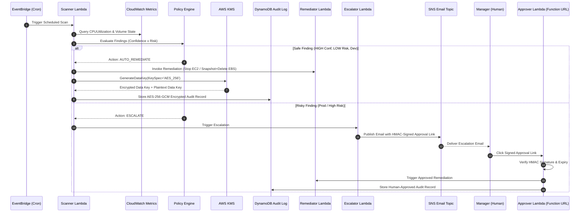

# Closed-Loop FinOps Auto-Remediation on AWS

[](https://www.python.org/)
[](https://aws.amazon.com/serverless/sam/)
[](https://docs.pytest.org/)
[](https://aws.amazon.com/free/)

An enterprise-grade, serverless cloud cost optimization system built for **PixelForge Studios** (demo tenant). On an automated EventBridge schedule, the system scans an AWS account for wasted cloud resources (idle EC2 instances, unattached EBS volumes), scores each finding by confidence and risk, auto-remediates safe resources, escalates risky resources to human owners via signed email approval links, and records every decision in a **KMS-encrypted DynamoDB audit log**.

---

## Key Features

- **Waste Detection**: Detects idle EC2 instances (CPU < 5.0% over idle window with network activity cross-checking) and unattached EBS volumes (`available` state).
- **Multi-Factor Decision Engine**: Matrix evaluation combining Confidence scoring and Risk scoring with safety guards and circuit breaker.
- **Per-Company Policy Overrides**: JSON policy definitions per tenant (e.g., `policies/pixelforge.json`).
- **Authentic KMS Envelope Encryption**: Sensitive audit details are encrypted using `KMS GenerateDataKey` + `AES-256-GCM` with cryptographic `EncryptionContext` isolation per tenant before storage in DynamoDB.
- **Human-in-the-Loop Escalation**: High-risk findings trigger SNS email alerts containing 48-hour HMAC-SHA256 signed approval URLs with conditional-write replay prevention.
- **Circuit Breaker Guard**: Limits automated remediation actions per run (default: 5) to prevent runaway deletions.
- **Secure Cross-Account Onboarding**: Connects to external accounts via `sts:AssumeRole` with cryptographically secure `ExternalId` (>= 32 chars) and automated least-privilege self-check. Zero raw IAM keys stored or accepted.
- **Transparent & Honest Cost Modeling**: Clearly documents actual AWS costs (~$1/month for KMS Customer Managed Key storage, $0.05/GB-month for EBS snapshots) while strictly staying within Free Tier limits for compute, storage, metrics, and logs.

---

## Architecture Diagram



---

## Decision Engine Matrix

| Confidence | Risk | Recommended Action | Description |
| :--- | :--- | :--- | :--- |
| **HIGH** | **LOW** | `AUTO_REMEDIATE` | Dev/QA environment, idle duration exceeded, owner present → Safe to stop/delete |
| **HIGH** | **HIGH** | `ESCALATE` | Production environment or `keep=true` tag → Requires human manager approval |
| **LOW** | **LOW** | `ESCALATE` | Short idle duration → Request manual check before taking action |
| **LOW** | **HIGH** | `LOG_ONLY` | Low confidence + High risk → Record in audit log only |

### Safety Guards (Pre-Evaluation)
1. **Scope Tag Guard**: Resource MUST have `Project=finops-demo` tag. Un-tagged resources are **skipped**.
2. **Keep Guard**: Resource with `keep=true` tag is forced to `LOG_ONLY`.
3. **Prod Guard**: Production environment (`env=prod`) can **never** be auto-remediated (overridden to `ESCALATE`).
4. **Circuit Breaker**: Automatically trips after 5 automated remediations per run, converting further `AUTO_REMEDIATE` actions to `ESCALATE`.

---

## KMS Envelope Encryption Flow

```
[Plaintext Audit Record] 
           │
           ├───► KMS GenerateDataKey(KeyId="alias/finops-key", KeySpec="AES_256")
           │           │
           │           ├───► Plaintext Data Key (32 bytes)
           │           └───► Encrypted Data Key (CiphertextBlob)
           │
           ├───► AES-256-GCM Encrypt (Plaintext Data Key + 12-byte Nonce)
           │           │
           │           └───► Ciphertext Payload
           │
           └───► Wipes Plaintext Data Key from Memory
                       │
                       ▼
          [DynamoDB Audit Record]
          - log_id (Partition Key)
          - timestamp, resource_id, action_taken (Searchable)
          - ciphertext_b64 (Encrypted Payload)
          - encrypted_data_key_b64 (KMS CiphertextBlob)
          - nonce_b64 (AES-GCM Nonce)
```

---

## AWS SAM Infrastructure

The SAM template ([template.yaml](template.yaml)) defines all serverless resources:

- **DynamoDB Table**: `finops-audit-log` (Provisioned 5 RCU / 5 WCU with CMK SSE, TTL)
- **KMS Key & Alias**: `alias/finops-key` (Envelope Encryption)
- **SNS Topic**: `finops-escalation-topic` (Manager Email Notifications)
- **SSM Parameter**: `/finops/hmac-secret` (HMAC Signing Key stored as SecureString)
- **Lambda Functions**:
  - `ScannerFunction`: `src.scanner.app.handler`
  - `RemediationFunction`: `src.remediation.handler.handler`
  - `EscalationFunction`: `src.escalation.handler.handler`
  - `ApprovalFunction`: `src.approval.handler.handler` (Free Lambda Function URL)
- **Auditor IAM Role**: `FinOpsAuditorRole` (Separation of duties: solitary holder of `kms:Decrypt`)
- **EventBridge Rule**: Daily automated cron execution
- **CloudWatch Dashboard**: `FinOps-AutoRemediation-Dashboard`

---

## Project Structure

```
FinOpsRemediation/
├── template.yaml                  # AWS SAM Infrastructure Template
├── requirements-dev.txt           # Python Dependencies (boto3, moto, pytest, cfn-lint)
├── policies/
│   └── pixelforge.json            # Per-company policy rules (PixelForge Studios)
├── prices/
│   └── prices.json                # EC2/EBS AWS Pricing Reference
├── src/
│   ├── config.py                  # Environment Configuration Loader
│   ├── policy_engine.py           # Core Policy Decision Engine
│   ├── scanner/
│   │   ├── app.py                 # Scanner Lambda Orchestrator
│   │   ├── ec2_scanner.py         # EC2 Idle Instance Scanner
│   │   └── ebs_scanner.py         # EBS Unattached Volume Scanner
│   ├── crypto/
│   │   └── envelope.py            # KMS AES-256-GCM Envelope Encryption
│   ├── audit/
│   │   └── writer.py              # DynamoDB Encrypted Audit Log Writer/Reader
│   ├── remediation/
│   │   └── handler.py             # EC2 Stop & EBS Snapshot/Delete Handler
│   ├── escalation/
│   │   └── handler.py             # SNS Email & HMAC Approval Link Generator
│   └── approval/
│       └── handler.py             # API Gateway Approval Endpoint
├── scripts/
│   ├── seed.py                    # Seeds demo EC2 & EBS infrastructure
│   ├── report.py                  # Decrypts audit log & prints FinOps summary
│   ├── teardown.py                # Cleans up demo resources
│   └── show_kms_events.py         # Displays KMS audit trail events
└── tests/                         # Comprehensive Moto Test Suite (127 tests)
    ├── test_policy_engine.py      # 32 policy engine tests
    ├── test_scanner.py            # 16 scanner tests
    ├── test_crypto.py             # 7 envelope encryption & BYOK tests
    ├── test_audit.py              # 3 audit writer tests
    ├── test_remediation.py        # 5 remediation tests
    ├── test_escalation.py         # 7 escalation & HMAC tests
    ├── test_approval.py           # 8 approval API tests
    ├── test_metrics.py            # 6 metric publisher tests
    ├── test_closed_loop_orchestration.py # 2 end-to-end pipeline tests
    ├── test_iam_policies.py       # 9 static IAM & KMS policy manifest tests
    └── test_web_server.py         # 32 live HTTP endpoint & multi-tenant tests
```

---

## Quickstart & Testing

### 1. Environment Setup
```powershell
# Create and activate virtual environment
python -m venv .venv
.\.venv\Scripts\Activate.ps1

# Install dependencies
pip install -r requirements-dev.txt
```

### 2. Run All Unit & Integration Tests (Zero AWS Credentials Needed)
```powershell
.\.venv\Scripts\python.exe -m pytest tests/ -v
```
*Expected Output:* **`127 passed`**

### 3. Validate SAM / CloudFormation Template
```powershell
.\.venv\Scripts\cfn-lint.exe template.yaml onboarding/finops-cross-account-role.yaml
```
*Expected Output:* **`0 errors, 0 warnings`**

---

## Demo Script Walkthrough

### 1. Seed Demo Environment
```powershell
.\.venv\Scripts\python.exe scripts/seed.py
```
*Creates mock idle EC2 instances, busy EC2 instances, and unattached EBS volumes.*

### 2. Run Audit Report Generator
```powershell
.\.venv\Scripts\python.exe scripts/report.py
```
*Decrypts KMS envelopes from DynamoDB and prints summary table of waste detected and cost savings.*

### 3. Show KMS Audit Events
```powershell
.\.venv\Scripts\python.exe scripts/show_kms_events.py
```

### 4. Clean Up Demo Resources
```powershell
.\.venv\Scripts\python.exe scripts/teardown.py
```

---

## Connecting to Real AWS Accounts (Cross-Account Architecture)

The system is architected for cross-account enterprise environments using AWS security best practices. It assumes least-privilege IAM roles in customer/tenant accounts using cryptographically secure external IDs, avoiding the storage or entry of raw AWS credentials.

### 3-Step Cross-Account Onboarding Wizard

1. **Step 1: Tenant Registration & ExternalId Generation**:
   - Open the web console at [http://localhost:8000](http://localhost:8000) and click **"🔗 Link AWS Account"**.
   - Enter your Tenant Name (e.g. `Acme Corp`).
   - Click **"Generate Onboarding Package"**. The backend issues a 40-character random `ExternalId` and provides the CloudFormation template:
     `onboarding/finops-cross-account-role.yaml`

2. **Step 2: Deploy CloudFormation Template in Customer Account**:
   - Deploy `onboarding/finops-cross-account-role.yaml` in your AWS account, passing the generated `ExternalId` and Platform Account ID.
   - The template provisions least-privilege roles:
     - `FinOpsScannerRole`: Read-only access to `ec2:Describe*` and `cloudwatch:GetMetricData`.
     - `FinOpsAutoRemediationRole`: Scoped auto-remediation permissions with `aws:ResourceTag/Project: finops-demo` condition and explicit DENYs for `env=prod` and `keep=true`.
     - `FinOpsApprovedRemediationRole`: Scoped permissions for human-approved actions, permitting `env=prod` but strictly denying `keep=true`.
     - `CustomerFinOpsKey` (Optional BYOK): Customer-managed KMS key granting platform `GenerateDataKey`/`Decrypt` conditioned on `kms:EncryptionContext:tenant_id`.

3. **Step 3: Encryption Choice & Live Verification**:
   - Select KMS encryption option:
     - **Platform Key (Shared)**: Uses platform CMK with `tenant_id` context isolation ($0 extra).
     - **Bring Your Own Key (BYOK)**: Enter Customer KMS Key ARN; customer retains revocation authority (~$1/mo prorated).
   - Click **"Test Connection"**:
     - Platform assumes the role via `sts:AssumeRole`.
     - Performs automated least-privilege self-check (`iam:ListUsers`). Fails closed if admin access is detected.
   - If `Scope: ALL Instances` is chosen, the system automatically forces **Dry Run Mode** for safety.

---

## Honest AWS Cost Breakdown & Free-Tier Guardrails

Rather than claiming a fictional "$0 bill", this architecture provides an honest and transparent cloud cost model:

| Service / Resource | Free Tier Allowance | Project Implementation | Projected Cost |
| :--- | :--- | :--- | :--- |
| **KMS Customer Managed Key** | First 20,000 API requests free/month | One CMK (`alias/finops-key`) for AES-256-GCM envelope encryption. Automatic key rotation is disabled (`EnableKeyRotation: false`) to avoid additional key fees. Optional customer BYOK key costs ~$1/mo prorated. | **~$1.00 / month** (prorated $0.033/day) |
| **EBS Snapshots** | 50 GB snapshot storage (first 12 mos) | Safety snapshots created before orphaned volume deletion. Snapshots use standard incremental storage. | **~$0.05 / GB-month** (or $0 during free tier) |
| **CloudWatch Custom Metrics** | 10 custom metrics free/month | Exactly **8 custom metrics** published to `FinOps` namespace with **zero dimensions** (no tenant dimensions) to avoid multi-series billing charges. | **$0.00** |
| **CloudWatch Alarms** | 10 standard alarms free/month | Exactly **3 CloudWatch Alarms** (`RemediationFailuresAlarm`, `CircuitBreakerTrippedAlarm`, `ScannerErrorsAlarm`). | **$0.00** |
| **CloudWatch Logs** | 5 GB ingestion & storage free/month | Retention configured to **7 days** on all Lambda log groups to prevent storage accumulation. | **$0.00** |
| **DynamoDB** | 25 RCU / 25 WCU free perpetually | Audit table configured with **Provisioned 5 RCU / 5 WCU** and KMS CMK Server-Side Encryption. | **$0.00** |
| **AWS Lambda** | 1M free invocations + 3.2M sec compute/mo | Serverless event-driven execution on EventBridge daily cron and approval Function URL. | **$0.00** |
| **AWS SNS** | 1,000 email notifications free/month | Encrypted escalation topic sending HMAC approval links. | **$0.00** |
| **Cost Explorer API** | None ($0.01 per API request) | **ELIMINATED**: Zero calls to Cost Explorer API. All idle detection uses standard CloudWatch metrics. | **$0.00** |
| **Networking & NAT** | None ($32+/month per NAT Gateway) | **ELIMINATED**: No NAT Gateways or VPC endpoints required. | **$0.00** |

**Total Estimated AWS Footprint:** ~**$1.00 / month** (prorated to pennies for transient test deployments).

---

## Known Limitations

1. **Moto Offline Testing Limitations**:
   - `moto` emulates AWS API syntax and data structures but does not evaluate IAM policies or KMS key policies. Static tests in `tests/test_iam_policies.py` parse CloudFormation manifests to ensure policy correctness, backed by the manual IAM Policy Simulator checklist below.
   - `moto`'s KMS implementation does not natively fail on `disable_key()`; this is explicitly enforced by our application code in `src/crypto/envelope.py` to ensure fail-closed security.
2. **SSM Parameter Store SecureString in CloudFormation**:
   - AWS CloudFormation does not support creating `SecureString` SSM parameters directly in templates. Therefore, `/finops/hmac-secret` must be created post-deploy via the AWS CLI (`aws ssm put-parameter --name /finops/hmac-secret --value <secret> --type SecureString --key-id alias/finops-key`).
3. **CloudTrail Event History Latency**:
   - AWS CloudTrail Event History has a 10–15 minute propagation latency before API calls (such as `kms:GenerateDataKey` or `kms:Decrypt`) become visible via `aws cloudtrail lookup-events`.
4. **Customer-Side Tagging in Read-Only Scanner Mode**:
   - In cross-account setups where the customer account grants only read-only scanner access, the scanner cannot write tags directly to customer EBS volumes. To solve this, "first seen unattached" timestamps are tracked in the platform's central DynamoDB table keyed by `(tenant_id, volume_id)`.

---

## Manual Real-AWS Verification Checklist

After deploying the SAM template to a real AWS account with `DRY_RUN=true`:

1. **Configure HMAC Secret as SecureString**:
   ```bash
   aws ssm put-parameter \
     --name /finops/hmac-secret \
     --value "$(openssl rand -hex 32)" \
     --type SecureString \
     --key-id alias/finops-key \
     --overwrite
   ```
2. **Confirm SNS Subscription**:
   - Check the inbox for the `EscalationEmail` specified during deployment.
   - Click **"Confirm subscription"** in the AWS Notification email.
3. **Verify IAM Policy Simulator Cases**:
   - **Scanner Role**:
     - Test `ec2:DescribeInstances` $\to$ **Allowed**.
     - Test `iam:ListUsers` $\to$ **Denied** (verifies least-privilege self-check will pass).
     - Test `ec2:StopInstances` $\to$ **Denied** (verifies scanner cannot alter state).
   - **Remediator Role**:
     - Test `ec2:StopInstances` with tag `Project=finops-demo` $\to$ **Allowed**.
     - Test `ec2:StopInstances` with tag `env=prod` $\to$ **Denied** (verifies prod guard).
     - Test `ec2:StopInstances` with tag `keep=true` $\to$ **Denied** (verifies keep guard).
     - Test `ec2:CreateSnapshot` on `arn:aws:ec2:*:*:volume/*` and `arn:aws:ec2:*:*:snapshot/*` $\to$ **Allowed**.
   - **Approver Role**:
     - Test `ec2:StopInstances` with tag `Project=finops-demo` and `env=prod` $\to$ **Allowed** (verifies human approval of prod).
     - Test `ec2:StopInstances` with tag `keep=true` $\to$ **Denied** (verifies keep=true is never touched).
4. **Verify KMS Separation of Duties**:
   - Verify `FinOpsAuditorRole` is the **only** role permitted to perform `kms:Decrypt`.
   - Verify `ScannerFunction`, `RemediationFunction`, and `ApprovalFunction` roles can only call `kms:GenerateDataKey*` and `kms:Encrypt`.
5. **Test Human-in-the-Loop Approval Link**:
   - Trigger a scan with `DRY_RUN=false` on an idle prod instance.
   - Verify escalation email is received via SNS with an HMAC approval URL.
   - Click link to load confirmation page; submit approval; verify resource remediated and recorded in DynamoDB.
6. **Verify CloudTrail Event History Proof of KMS Encryption**:
   ```bash
   aws cloudtrail lookup-events \
     --lookup-attributes AttributeKey=EventSource,AttributeValue=kms.amazonaws.com \
     --max-results 10
   ```
   - Confirm `GenerateDataKey` events from Lambda roles and `Decrypt` events from `FinOpsAuditorRole`.
